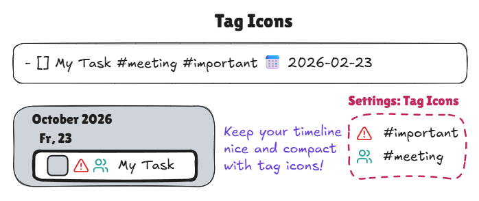
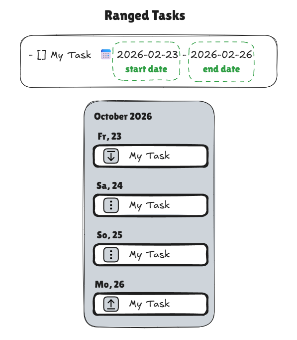
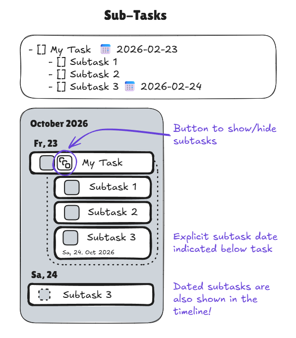
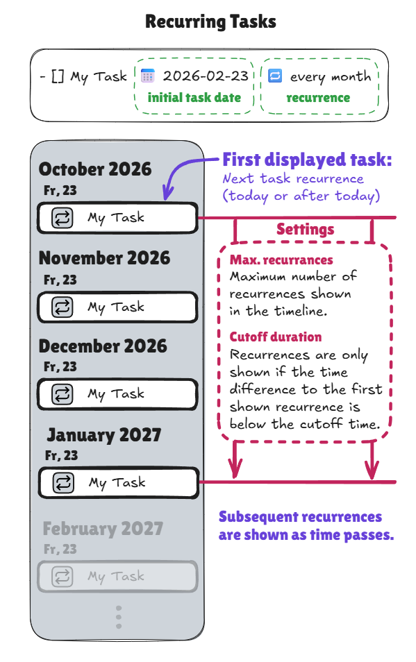

# Task Finder

A plugin to help you find (and edit) tasks inside your vault.  
(on Desktop and Mobile)

### Interested in contributing to the plugin?

There are many things you can do to help this plugin... just open an issue and get in touch!  
**Any help is highly appreciated!**

- improve code / fix issues / add features
- report issues
- provide suggestions for nice features
- write documentation / tutorials

## What do you get with the plugin?
### A queryable sidebar view to inspect (and edit) all tasks in your vault

## How does it work?

TaskFinder builds upon the icon-syntax introduced by the [**Tasks**](https://publish.obsidian.md/tasks/Introduction) plugin.

It handles **scheduled and unscheduled tasks** with optional **start- and end-time** as well as **ranged tasks** (e.g.: holidays, travels, ...) and **repeated tasks** (e.g.: birthdays, meetings ...).

It provides a **queryable** timeline-view of all tasks in your vault.  

To get a compact view, you can define **custom tag-icons** to represent tags in the timeline.  
Tasks with **priorities** assigned are highlighted in the timeline.

**Sub-tasks** are shown in a collapsible container below the parent task.  
(dated sub-tasks also appear as explicit tasks in the timeline)

You can **check tasks** by clicking the checkboxes in the view!  
(or change the setting to use "control-click" to avoid accidental clicks...)

Finally, TaskFinder provides a **"right-click menu"** and a **"left-click popup"** to quickly perform basic task edits such as **re-schedule**, **set priority**, **add/remove tag** etc.

### Quick-edit menu if you "right-click" on a task in the view

### Re-schedule menu if you "left-click" on a task in the view

### Tag Icons

You can define custom tag icons in the settings to get a nice compact view!  
Every tag that has an icon defined can also be added/removed via the right-click menu!

### Special Task Types

# Installation

Simply install the plugin from the CommunityPlugin list.
