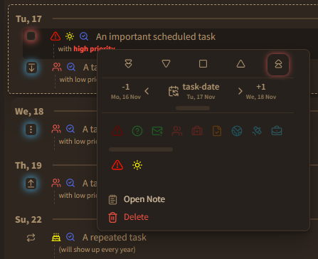

# Task Finder

A plugin to help you find tasks inside your vault.
(on Desktop and Mobile)

## What do you get with the plugin?
### A queryable sidebar view to inspect (and edit) all tasks in your vault

- Handle scheduled and unscheduled tasks
	- Start- and end-time
	- Multiple dates for a single task
	- Date-ranges
	- Repeated tasks
- Show additional text (indended text below the task)
- Tag icons
	- Set custom icons for your tags for a more compact view
- Task Priority
	- Highlight important tasks in the timeline
- Sub-tasks
	- Show sub-tasks in a collapsible container below the parent task

### Quick-edit menu if you "right-click" on a task in the view

- Set task-priority
- Re-schedule task relative to today (or relative to the task-date)
- Add/remove tags that have a configured tag-icon
- Open defining note
- Delete task

### Re-schedule menu if you "left-click" on a task in the view

- Change date and time with relative offsets or explicit (natural language) dates
	- Start/end date
	- Start/end time
- Set task priority
- Open defining note
- Delete task
