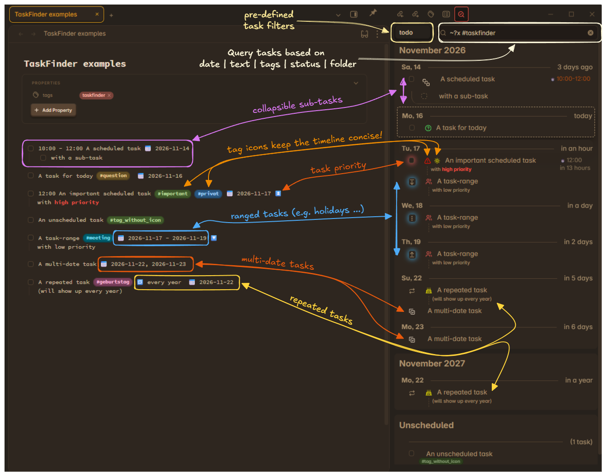
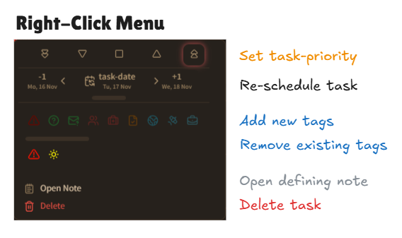
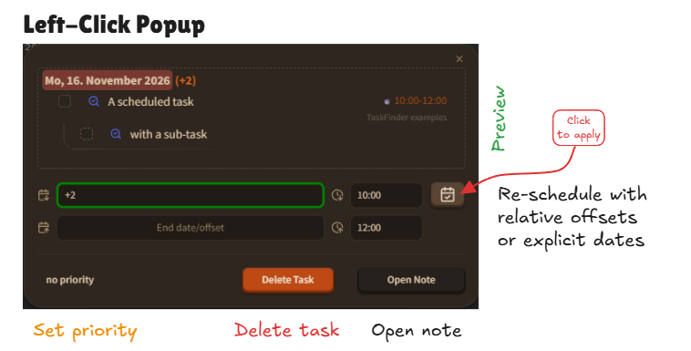
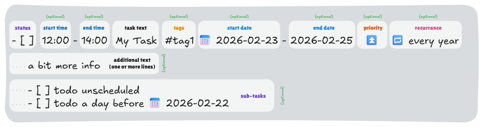

# Task Finder

A plugin to help you find (and edit) tasks inside your vault.  
(on Desktop and Mobile)

### Interested in contributing to the plugin?
**Any help is highly appreciated!** ... just open an issue and get in touch!  

## What do you get with the plugin?
### A queryable sidebar view to inspect (and edit) all tasks in your vault



## How does it work?

TaskFinder parses all tasks defined via the icon-syntax introduced by the [**Tasks**](https://publish.obsidian.md/tasks/Introduction) plugin.
It then provides a **queryable** timeline-view of all tasks in your vault.  
**"Left-click** or **Right-click"** on a task in the timeline to open quick-edit menus.

> To open the timeline, click on the ribbon-icon or run the `Task Finder: Find Tasks` command.







### Tag Icons

You can assign a custom **tag-icon** to a tag in the settings to get a nice compact view!  
Every tag that has an icon defined can also be added/removed via the right-click menu!


### Special Task Types


## Anatomy of a task


```
- [ ] 10:00  A scheduled task 📅 2026-11-14 
	- [ ] with a sub-task

- [ ] 10:00 - 00:00 Lets go on holiday! #privat 📅 2026-12-14 - 2026-12-17	
	- [ ] pack stuff for holiday 📅 2026-12-13 
		don't forget to pack suncream!
	- [ ] do nothing
	- [ ] travel to destination 📅 2026-12-14
	- [ ] travel home 📅 2026-12-20 

- [ ] A task for today #question  📅 2026-11-18 

- [ ] 12:00 An important scheduled task #important #privat 📅 2026-11-17 ⏫
	with **high priority**

- [ ] An unscheduled task #tag_without_icon

- [ ] A task-range #meeting 📅 2026-11-15 - 2026-11-19 🔽
	with low priority

- [ ] A multi-date task 📅 2026-11-22, 2026-11-23

- [ ] A repeated task #geburtstag 🔁 every year  📅 2026-11-22
	(will show up every year)
```

# Installation

Simply install the plugin from the CommunityPlugin list.
