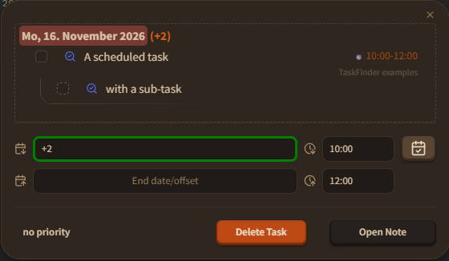

# Task Finder

A plugin to help you find tasks inside your vault.
(on Desktop and Mobile)

## What do you get with the plugin?
### A queryable sidebar view of all your tasks

- Handle scheduled and unscheduled tasks
	- start- and end-time
	- multiple dates for a single task
	- date-ranges
	- repeated tasks
- Show additional text (indended text below the task)
- Use tag icons
	- set custom icons for your tags for a more compact view
- Task Priority
	- highlight important tasks in the timeline
- Sub-tasks
	- show sub-tasks in a collapsible container below the parent task

### Quick-edit menu if you "right-click" on a task in the view

It allows you to:
- set task-priority
- re-schedule task relative to today (or relative to the task-date)
- add/remove tags that have a configured tag-icon
- open defining note
- delete task

### Re-schedule menu if you "left-click" on a task in the view

It allows you to:
- Change date and time with relative offsets or explicit (natural language) dates
	- start/end date
	- start/end time
- Set task priority
- Open defining note
- Delete task

