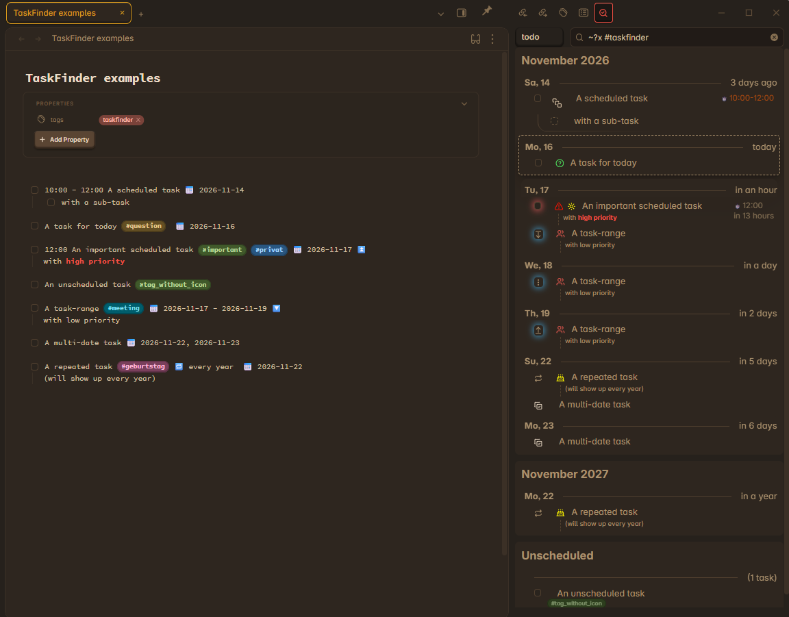

# Task Finder

A plugin to help you find tasks inside your vault.
(on Desktop and Mobile)

## What do I get with this plugin?

A command: `Task Finder: Find Tasks` to query all tasks in your vault based on date, tags and task-text and display them in a popup.

- Clicking on a task-text will open the defining note.
- Checking the checkmark will also update the task in the defining note.
 

## Query Language

### Dates

Examples:  

- `+-2w`: Show all tasks scheduled 2 weeks before and after today.
- `+`: Show all future tasks.

Set anchor-date `@...`

    - `@yyyymmdd` for specific day
    - `@mmdd` for month/day in current year
    - `@dd` for day in current month
    - `@` for today (default)
 
Set date-range: `(direction)(duration)(unit)`

- direction:
    - `+` for all days after 'anchor-date'
    - `-` for all days before 'anchor-date
- unit:
    - `d` for days   
    - `w` for weeks
    - `m` for months
    - `y` for years

### Tags
Examples:  

- `#my_tag`: Include only tasks with the tag #my_tag
- `~#my_tag`: Include only tasks without the tag #my_tag

### Task Status

Examples:

- `?x`: show only checked tasks (`- [x]`)
- `~?x`: show only unchecked tasks (`- [ ]` or custom task-statuses)
- `~?n`: show only tasks with the custom status `- [n]` 

### Path

Examples:

- `$Path/To/My/Folder`: show only tasks defined in notes within the folder "Path/To/My/Folder"
